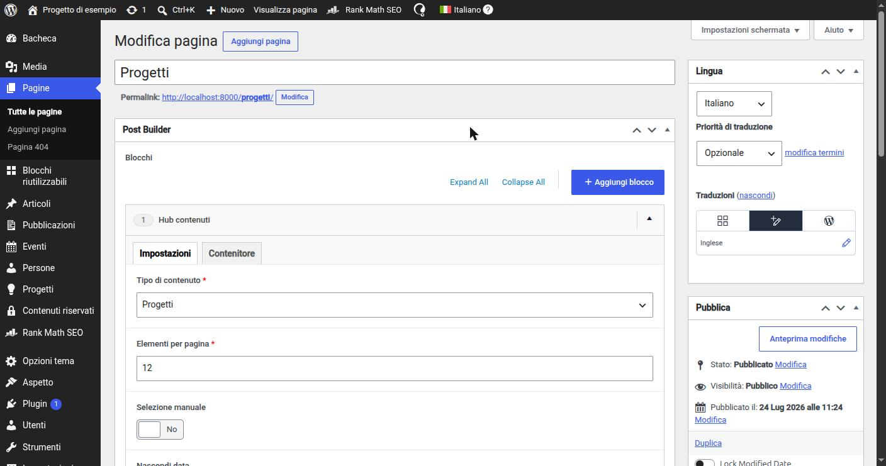
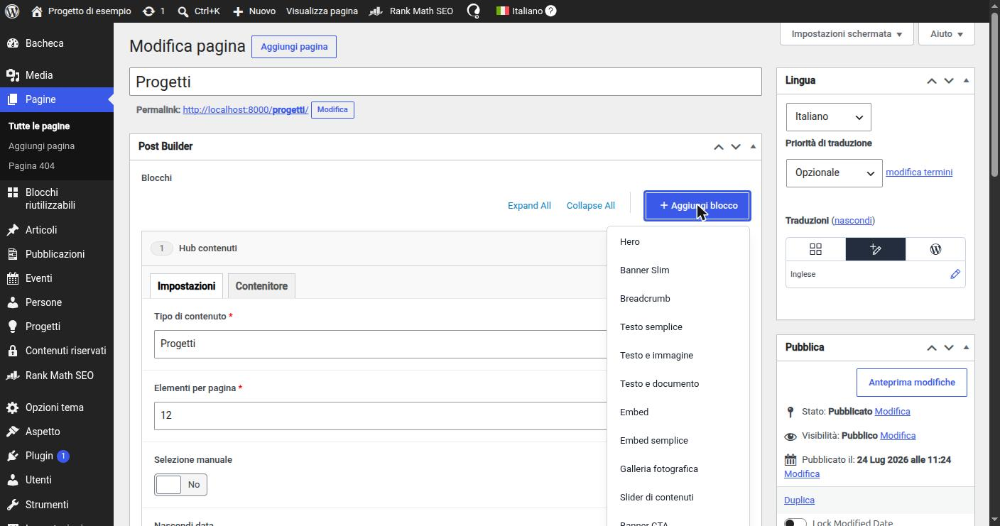

# 7. Il Post Builder: pagine a blocchi con Flexible Content

> 📁 **File coinvolti** ([mappa del progetto](02-struttura-progetto.md)): `page.php` · `includes/PostBuilder/AbstractFlexibleBuilder.php` · `includes/PostBuilder/AbstractBlock.php` · `includes/PostBuilder/PostBuilder.php` · `includes/PostBuilder/SinglePostBuilder.php` · `includes/PostBuilder/Blocks/` · `parts/post-builder/`

## Il concetto

Il **Flexible Content** di ACF è un campo che contiene una lista ordinata di "layout", ciascuno con i propri sotto-campi. Il redattore clicca "Aggiungi blocco", sceglie un tipo (Hero, Testo e immagine, Hub contenuti…), lo compila, lo riordina con il drag & drop. Il risultato è un page builder controllato: **i redattori compongono, ma solo con blocchi progettati e coerenti col design system**.


*Il Post Builder in una pagina: ogni blocco è un layout del Flexible Content, con i suoi campi organizzati in schede. La scheda "Contenitore" è quella condivisa da quasi tutti i blocchi (`ContainerTabFields`).*


*Il menu "Aggiungi blocco": l'elenco dei layout, nell'ordine definito dalla costante `ORDER` di `PostBuilder`.*

**Perché non Gutenberg (l'editor a blocchi nativo di WordPress)?**

- i blocchi Gutenberg salvano HTML nel contenuto del post: cambiare il markup di un blocco richiede migrazioni o "deprecations";
- un blocco Gutenberg va scritto in React per l'editor, mentre qui il rendering è Vue;
- con ACF i dati sono **strutturati** (campi separati, non HTML) e il markup è generato al momento della visualizzazione: cambiare un componente aggiorna istantaneamente tutte le pagine;
- per i redattori, un modulo con campi etichettati è più semplice e meno soggetto a "rompere" il layout.

Per questo l'editor di WordPress è nascosto sulle pagine (`hide_on_screen: ['the_content']`) e i CSS dei blocchi Gutenberg sono rimossi (`Cleanup/BlockAssets`).

## L'architettura in tre livelli

```
AbstractFlexibleBuilder            (registra il campo Flexible Content e fa il render loop)
 ├── PostBuilder                   (builder completo: pagine, blocchi riutilizzabili, 404)
 └── SinglePostBuilder             (builder ridotto: dettaglio dei CPT e articoli)

AbstractBlock                      (contratto di un blocco: layoutName, acfLayout, render)
 ├── Blocks/Hero
 ├── Blocks/TextAndImage
 └── ...
```

### `AbstractBlock`: il contratto di un blocco

Ogni blocco è una classe in `PostBuilder/Blocks/` che dichiara:

```php
final class TextAndImage extends AbstractBlock
{
    // nome macchina del layout ACF
    public static function layoutName(): string
    {
        return 'text_and_image';
    }

    // i campi del blocco
    public static function acfLayout(): Layout
    {
        return Layout::make(__('Text and Image', 'wpx-starter'), static::layoutName())
            ->layout('block')
            ->fields([
                Tab::make(__('Settings', 'wpx-starter'), 'tab_settings'),
                WYSIWYGEditor::make(__('Text', 'wpx-starter'), 'text')->required()->wpmlTranslate(),
                Image::make(__('Image', 'wpx-starter'), 'image')->required()->format('array')->wpmlCopy(),
                Link::make(__('Link', 'wpx-starter'), 'link')->wpmlTranslate(),
                ...ContainerTabFields::fields(),
            ]);
    }
}
```

Il metodo `render()` ereditato include il template PHP con lo **stesso nome in kebab-case**:

```
layoutName() = 'text_and_image'  →  parts/post-builder/text-and-image.php
```

e gli passa l'istanza del blocco in `$args['block']`, da cui il template legge i sotto-campi con `$block->getSubField('text', '')`.

Un blocco può anche fare l'override di `render()` quando non ha un template proprio: `ReusableBlockSelector` per esempio renderizza il Post Builder di un altro contenuto (un "Blocco riutilizzabile", vedi [sezione 9](09-blocchi-riutilizzabili.md)).

### `AbstractFlexibleBuilder`: registrazione e rendering

Un builder concreto dichiara: chiave e nome del campo, titolo, **dove** compare (`locations()`) e **quali blocchi** offre (`blockClasses()`). La classe base fa il resto:

- `registerFieldGroup()` raccoglie gli `acfLayout()` di tutti i blocchi e registra un unico campo Flexible Content;
- `render($postId)` cicla sulle righe salvate, trova la classe del blocco tramite `layoutName()` e chiama `->render()`.

```php
// page.php
get_header();
the_post();
PostBuilder::render();
get_footer();
```

Il render ha anche una **protezione dalla ricorsione infinita**: se un blocco riutilizzabile includesse (direttamente o indirettamente) se stesso, il builder lo riconosce e si ferma.

### Due builder, due strategie di selezione dei blocchi

| Builder             | Dove                                                              | Strategia                                                                                        |
|---------------------|-------------------------------------------------------------------|--------------------------------------------------------------------------------------------------|
| `PostBuilder`       | Pagine (template di default), Blocchi riutilizzabili, opzioni 404 | **Auto-discovery**: tutte le classi in `Blocks/`, meno una `BLACKLIST`, ordinate secondo `ORDER` |
| `SinglePostBuilder` | Dettaglio di CPT e articoli                                       | **Whitelist esplicita**: solo i blocchi di contenuto adatti a un "articolo"                      |

**Perché due strategie?** Le pagine sono il caso generale: ogni nuovo blocco deve esserci disponibile senza dimenticanze, quindi auto-discovery (i blocchi non elencati in `ORDER` finiscono in coda, mai persi). Il dettaglio di un contenuto ha già un hero e una sezione "correlati" fissi: lì ha senso solo un sottoinsieme ristretto di blocchi (testo, immagini, embed, download…), quindi la lista è esplicita.

---

← [6. ACF ed Extended ACF: i campi personalizzati in codice](06-acf.md) · [Indice](README.md) · [8. Ricetta: creare un nuovo blocco dall'inizio alla fine](08-ricetta-nuovo-blocco.md) →
