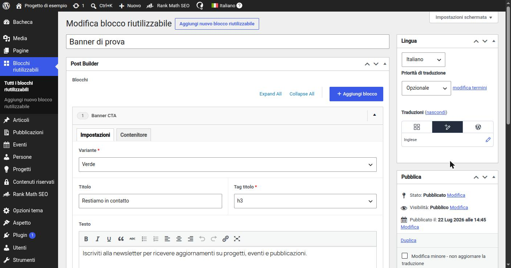

# 9. Blocchi riutilizzabili

> 📁 **File coinvolti** ([mappa del progetto](02-struttura-progetto.md)): `includes/PostTypes/ReusableBlockPostType.php` · `includes/PostBuilder/Blocks/ReusableBlockSelector.php` · `includes/PostBuilder/AbstractFlexibleBuilder.php`

## Il problema

Alcuni contenuti si ripetono identici su molte pagine: un banner di iscrizione alla newsletter, una call to action verso la pagina contatti, una striscia di numeri chiave. Inserirli come blocchi normali significa compilarli N volte e, soprattutto, **aggiornarli N volte** quando cambia un testo.

## La soluzione: un contenuto che contiene blocchi

I blocchi riutilizzabili sono composti da tre pezzi.

**1. Un custom post type non pubblico** (`PostTypes/ReusableBlockPostType.php`):

```php
register_post_type('reusable_block', [
    'public'              => false,  // nessun URL: non è una pagina del sito
    'publicly_queryable'  => false,
    'show_ui'             => true,   // ma ha la sua voce in bacheca
    'show_in_menu'        => true,
    'exclude_from_search' => true,
    'rewrite'             => false,
    'supports'            => ['title'], // il titolo serve solo a riconoscerlo nel selettore
    'menu_icon'           => 'dashicons-screenoptions',
]);
```

**2. Il Post Builder completo attivo anche su quel post type** (`PostBuilder::locations()`):

```php
Location::where('post_type', 'reusable_block'),
```

Quindi un blocco riutilizzabile si compone **con gli stessi blocchi di una pagina**: può contenerne uno o più, in sequenza.


*Un blocco riutilizzabile in bacheca: c'è solo il titolo e lo stesso Post Builder delle pagine. Non c'è il permalink sotto il titolo, perché il post type non è pubblico.*

**3. Un blocco "selettore"** (`PostBuilder/Blocks/ReusableBlockSelector.php`) disponibile nel Post Builder delle pagine. Ha un solo campo, la scelta del blocco riutilizzabile, e fa l'override di `render()`:

```php
final class ReusableBlockSelector extends AbstractBlock
{
    public static function layoutName(): string
    {
        return 'reusable_block';
    }

    public static function acfLayout(): Layout
    {
        return Layout::make(__('Reusable Block', 'wpx-starter'), static::layoutName())
            ->layout('block')
            ->fields([
                PostObject::make(__('Reusable block', 'wpx-starter'), 'selected_reusable_block')
                    ->postTypes(['reusable_block'])
                    ->format('id')
                    ->required()
                    ->wpmlCopy(),
            ]);
    }

    public function render(): void
    {
        $postId = (int) $this->getSubField('selected_reusable_block');
        if (!$postId) {
            return;
        }

        // l'ID salvato è quello della lingua originale: va risolto nella lingua corrente
        $postId = Wpml::getInstance()->translateObjectId($postId, 'reusable_block');
        if (!$postId) {
            return;
        }

        PostBuilder::render($postId);
    }
}
```

Non c'è un template `parts/post-builder/reusable-block.php` e non c'è un componente Vue: il selettore **rimpiazza se stesso con i blocchi del contenuto scelto**, renderizzati in linea. Nel markup finale non resta alcuna traccia del "contenitore": la pagina risulta identica a una in cui quei blocchi fossero stati inseriti a mano.

```
Pagina "Chi siamo"                      Blocco riutilizzabile "Newsletter"
├─ Hero                                 ├─ Testo semplice
├─ Testo e immagine                     └─ Iscrizione newsletter
├─ Blocco riutilizzabile ─────────────►
└─ Hub persone

HTML risultante: Hero, Testo e immagine, Testo semplice, Iscrizione newsletter, Hub persone
```

## Protezione dalla ricorsione

Anche dentro un blocco riutilizzabile si può inserire il selettore (è lo stesso Post Builder). Questo permette di annidarli, ma anche di creare un ciclo: A include B, B include A, all'infinito.

`AbstractFlexibleBuilder::render()` tiene una pila degli ID in corso di rendering, separata per builder:

```php
self::$renderingStack[static::class] ??= [];
if (in_array($resolvedId, self::$renderingStack[static::class], true)) {
    return; // questo contenuto è già in fase di rendering più in alto: stop
}

self::$renderingStack[static::class][] = $resolvedId;
// ... render dei blocchi ...
array_pop(self::$renderingStack[static::class]);
```

Il ciclo viene quindi interrotto al secondo ingresso, senza errori: il redattore vedrà semplicemente il contenuto una volta sola.

## Dove è disponibile

Il selettore è nel `PostBuilder` (pagine, blocchi riutilizzabili, 404) ma **non** nel `SinglePostBuilder`: il dettaglio di un contenuto ha una struttura fissa e un set di blocchi ristretto, e i blocchi riutilizzabili tipicamente contengono moduli "da pagina" (banner, CTA, form) che lì non sono previsti.

## Multilingua

- il blocco riutilizzabile è un post come gli altri: WPML ne crea una versione per lingua;
- nelle pagine il campo di selezione è `wpmlCopy()`: la scelta "quale blocco" è la stessa in tutte le lingue, e al render l'ID viene tradotto con `translateObjectId()`. Se la traduzione non esiste, il blocco non viene mostrato (invece di mostrare il contenuto nella lingua sbagliata).

## Ricerca interna

Il contenuto di un blocco riutilizzabile appartiene, ai fini della ricerca, **alle pagine che lo includono**. Il modulo `Search/` ne tiene conto:

- `reusable_block` è escluso dai post type indicizzati direttamente (non ha URL, non può essere un risultato);
- quando l'indicizzatore incontra un selettore in una pagina, legge i campi del blocco riutilizzabile referenziato e li aggiunge all'indice **di quella pagina**;
- poiché modificare un blocco riutilizzabile non "salva" le pagine che lo usano, un cron periodico riallinea l'indice.

I dettagli sono nella [sezione 11](11-ricerca.md).

## Perché un CPT e non una options page?

Una options page contiene **un solo** set di valori; i blocchi riutilizzabili invece sono **tanti**, ognuno con un titolo, un elenco in bacheca, una cronologia delle revisioni e la gestione delle traduzioni di WPML. Tutte cose che un post type offre già.

---

← [8. Ricetta: creare un nuovo blocco dall'inizio alla fine](08-ricetta-nuovo-blocco.md) · [Indice](README.md) · [10. Icone selezionabili dai redattori](10-icone.md) →
