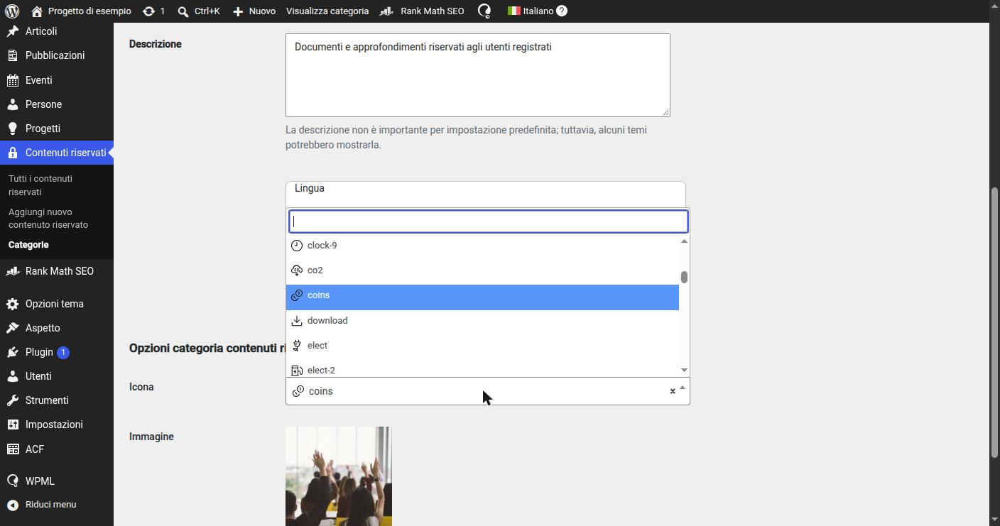

# 10. Icone selezionabili dai redattori

> 📁 **File coinvolti** ([mappa del progetto](02-struttura-progetto.md)): `parts/icons/*.svg` · `includes/AcfFields/Partials/IconSelectField.php` · `includes/Setup/AcfIconSelectAssets.php` · `assets/admin/acf-icon-select.{js,css}` · `includes/Support/Html.php`

Alcuni blocchi (Banner slim, Striscia tag, Modulo di contatto, le categorie dell'area riservata…) permettono al redattore di **scegliere un'icona** da un menu a tendina con anteprima.

## Le icone sono file del tema

Le icone sono file SVG in `parts/icons/`, versionati in Git insieme al tema:

```
parts/icons/
├── calendar.svg
├── leaf.svg
├── handshake.svg
└── ...
```

Ogni SVG è disegnato per ereditare il colore dal CSS, usando `currentColor`:

```xml
<svg viewBox="0 0 48 48" fill="none" xmlns="http://www.w3.org/2000/svg">
  <path d="M4 41.99…" stroke="currentColor" stroke-width="2.75" stroke-linecap="round" stroke-linejoin="round"/>
</svg>
```

**Perché file del tema e non immagini caricate in Libreria Media?**

- **coerenza grafica**: il set di icone è deciso dal design, non dai redattori; tutte hanno lo stesso stile e lo stesso `viewBox`;
- **sicurezza**: un SVG può contenere JavaScript. Le icone del tema sono asset controllati, mentre un SVG caricato da un utente va sanificato;
- **colore controllabile**: grazie a `currentColor` e all'inserimento inline, la stessa icona è bianca su fondo scuro e blu su fondo chiaro, decidendolo dal CSS;
- **valore salvato stabile**: nel database si salva il **nome** dell'icona (`"leaf"`), non l'ID di un allegato che cambia tra ambienti.

## Il campo: `AcfFields/Partials/IconSelectField`

Una factory che restituisce un campo `Select` di Extended ACF, con le opzioni **generate leggendo la cartella**:

```php
final class IconSelectField
{
    public static function make(string $label, string $name, ?string $default = null): Select
    {
        return Select::make($label, $name)
            ->choices(self::choices())
            ->stylized()                              // select con ricerca (select2)
            ->nullable()                              // l'icona è facoltativa
            ->default($default)
            ->format('value')
            ->wrapper(['class' => 'wpx-icon-select']) // "marcatore" per l'anteprima in bacheca
            ->wpmlCopy();                             // stessa icona in tutte le lingue
    }

    private static function choices(): array
    {
        $files = glob(get_template_directory() . '/parts/icons/*.svg') ?: [];
        $names = array_map(static fn (string $file): string => basename($file, '.svg'), $files);
        sort($names);

        return array_combine($names, $names); // ['calendar' => 'calendar', 'leaf' => 'leaf', ...]
    }
}
```

Si usa in qualsiasi gruppo di campi o blocco come un campo normale:

```php
IconSelectField::make(__('Icon', 'wpx-starter'), 'icon'),
```

**Aggiungere un'icona = copiare un file SVG in `parts/icons/`.** Nessuna modifica al codice: comparirà nel menu di tutti i campi icona.

## L'anteprima in bacheca

Un menu a tendina con soli nomi di file ("heart-handshake", "heand-heart"…) è poco utilizzabile. `Setup/AcfIconSelectAssets` carica, **solo nelle schermate con campi ACF**, un piccolo JS e CSS (`assets/admin/acf-icon-select.{js,css}`):

```php
add_action('acf/input/admin_enqueue_scripts', [$this, 'enqueue']);

// ...
wp_enqueue_script('wpx-acf-icon-select', $uri . '/assets/admin/acf-icon-select.js', ['jquery', 'acf-input'], (string) filemtime($jsPath), true);

// passa al JS l'URL della cartella icone
wp_localize_script('wpx-acf-icon-select', 'wpxIconSelect', [
    'iconsUrl' => get_template_directory_uri() . '/parts/icons/',
]);
```

Il JS si aggancia a un filtro JavaScript di ACF che permette di modificare la configurazione di select2, e lo fa **solo** per i campi dentro `.wpx-icon-select` (la classe impostata dal `wrapper()` del campo):

```js
acf.addFilter('select2_args', function (args, $select) {
  if (!$select.closest('.wpx-icon-select').length) {
    return args; // tutti gli altri select di ACF restano invariati
  }

  args.templateResult = iconOption;    // voci della tendina
  args.templateSelection = iconOption; // valore selezionato
  return args;
});

function iconOption(state) {
  if (!state.id) return state.text;
  return $('<span class="wpx-icon-select-option"><span>' + state.text + '</span></span>');
}
```

Il risultato è una tendina con l'anteprima dell'icona accanto a ogni nome, sia nell'elenco sia nel valore scelto. La versione degli asset è il `filemtime` del file: ogni modifica invalida la cache del browser senza gestire numeri di versione.


*Il campo icona in bacheca: le opzioni sono i nomi dei file in `parts/icons/`, e l'anteprima è aggiunta dal JS di `AcfIconSelectAssets`.*

## Il rendering: SVG inline come slot

Nel template PHP l'icona si stampa con `Html::svgIcon()`, che legge il file e restituisce il markup SVG:

```php
public static function svgIcon(string $name): string
{
    // basename() impedisce path traversal (es. "../../wp-config")
    $path = get_template_directory() . '/parts/icons/' . basename($name) . '.svg';

    if (!file_exists($path)) {
        return '';  // icona rimossa o rinominata: semplicemente non si mostra
    }

    return (string) file_get_contents($path);
}
```

e la passa al componente Vue come **slot**:

```php
// parts/post-builder/banner-slim.php
$icon = $block->getSubField('icon', '');
?>
<wp-proxy-cmp data-component="BannerSlimCmp">
    <?php if (!empty($icon)) { ?>
    <div data-v-slot="icon"><?php echo Html::svgIcon($icon); ?></div>
    <?php } ?>
    <div data-v-slot="text"><?php echo esc_html($text); ?></div>
</wp-proxy-cmp>
```

Il componente decide dimensione e colore con il CSS:

```vue
<IconGradientCmp class="icon-wrapper">
  <slot name="icon" />
</IconGradientCmp>

<style scoped>
.icon-wrapper :deep(svg) {
  /* dimensioni; il colore arriva da `color` grazie a currentColor */
}
</style>
```

**Perché SVG inline e non ``?** Un SVG caricato con `` è un documento isolato: il CSS della pagina non può cambiarne il colore e `currentColor` non funziona. Inline invece è parte del DOM, eredita `color` e non richiede una richiesta HTTP in più.

## Attenzione

- **Rinominare o eliminare un file** rompe i valori già salvati con quel nome: i blocchi che lo usavano non mostreranno più l'icona (nessun errore, solo l'icona assente). Prima di rimuovere un'icona conviene cercarne l'uso nel database.
- Gli SVG vanno **puliti** prima di aggiungerli (niente `width`/`height` fissi, colori in `currentColor`, nessuno script o metadato dell'editor grafico), perché vengono stampati così come sono.
- Queste icone sono diverse da quelle di **interfaccia** usate dentro i componenti Vue (frecce, chiusura, menu): quelle vengono da `@lucide/vue` (`<LucideArrowRight />`, vedi [sezione 21](21-frontend-componenti.md)) e non sono scelte dai redattori.

## Altri approcci possibili

La soluzione descritta (file SVG nel tema, inseriti inline) è adatta quando il set di icone è **piccolo, disegnato su misura e controllato dal design**. Non è l'unica possibile. Se il progetto parte da una libreria esistente, o le icone sono centinaia, altre strade possono essere più comode.

Qualunque approccio si scelga, la parte "editoriale" si costruisce con gli **stessi tre pezzi** visti sopra, e si può replicare cambiando solo l'implementazione di ciascuno:

| Pezzo                    | Cosa deve fare                                           | Implementazione attuale                         |
|--------------------------|----------------------------------------------------------|-------------------------------------------------|
| **Elenco delle scelte**  | Produrre le opzioni del `Select` (`valore => etichetta`) | `glob()` su `parts/icons/*.svg`                 |
| **Anteprima in bacheca** | Mostrare l'icona accanto a ogni opzione                  | filtro `select2_args` di ACF + `` sull'SVG |
| **Rendering**            | Trasformare il valore salvato in markup sul sito         | `Html::svgIcon()` → SVG inline in uno slot      |

Il valore salvato nel database resta sempre una **stringa con il nome dell'icona**, quindi cambiare approccio in futuro non richiede di migrare i dati, purché i nomi restino gli stessi.

### Webfont di una libreria di icone

Librerie come Font Awesome, Material Symbols o Bootstrap Icons sono distribuite anche come **font**: ogni icona è un carattere, mostrato con una classe CSS o con una "ligatura" (una parola che il font trasforma in icona).

```php
// 1. Elenco: un elenco curato di nomi (o letto dal file di metadati della libreria)
final class FontIconSelectField
{
    private const ICONS = ['eco', 'handshake', 'calendar_month', 'mail', 'groups'];

    public static function make(string $label, string $name): Select
    {
        return Select::make($label, $name)
            ->choices(array_combine(self::ICONS, self::ICONS))
            ->stylized()
            ->nullable()
            ->format('value')
            ->wrapper(['class' => 'wpx-font-icon-select'])
            ->wpmlCopy();
    }
}
```

```js
// 2. Anteprima: il CSS del font va caricato anche in bacheca; select2 mostra il carattere
function iconOption(state) {
  if (!state.id) return state.text;
  return $('<span><span class="material-symbols-outlined">' + state.id + '</span> ' + state.text + '</span>');
}
```

```php
// 3. Rendering: un semplice elemento con la classe/ligatura
<div data-v-slot="icon">
    <span class="material-symbols-outlined" aria-hidden="true"><?php echo esc_html($icon); ?></span>
</div>
```

- ✅ centinaia di icone pronte, nessun file da gestire; il colore si controlla con `color`, la dimensione con `font-size`;
- ⚠️ si scarica l'intero font (va fatto il *subsetting* se si usano poche icone), può esserci un "lampo" prima del caricamento del font, le icone sono monocolore, e si aggiunge una dipendenza esterna (eventualmente da CDN, con implicazioni privacy/GDPR).

### Sprite SVG

Tutte le icone in un unico file SVG, ciascuna come `<symbol id="…">`, richiamate con `<use>`:

```php
// Rendering
<svg aria-hidden="true"><use href="<?php echo esc_url($spriteUrl . '#' . $icon); ?>"></use></svg>
```

L'elenco delle scelte si ottiene leggendo gli `id` dei `<symbol>` nel file. Un'unica richiesta, messa in cache dal browser, e con `currentColor` il colore resta controllabile da CSS. È una via di mezzo tra file singoli e webfont.

### Libreria di icone come componenti Vue

Il progetto usa già `@lucide/vue` per le icone di interfaccia. Si potrebbero rendere editoriali anche quelle: PHP salva e passa solo il **nome** come prop (`'icon' => 'leaf'`), e il componente Vue risolve il componente icona corrispondente.

In questo caso serve una **mappa esplicita** delle icone ammesse, per lo stesso motivo del registry dei componenti ([sezione 20](20-frontend-proxy.md)): un import dinamico "per nome" includerebbe nel bundle l'intera libreria. La stessa lista va usata anche per le scelte del campo ACF, ad esempio generandola in un JSON condiviso tra PHP e frontend. Contro: l'icona esiste solo dopo il mount di Vue, quindi non compare nell'HTML del server.

### Caricamento libero da Libreria Media

Un campo `Image` che accetta SVG lascia ai redattori la massima libertà. Ma si perde la coerenza grafica, e ogni SVG caricato **va sanificato**: il tema include già `enshrined/svg-sanitize` per questo. Per lo stesso motivo l'SVG non va mai stampato inline senza prima averlo sanificato.

### Come scegliere

| Situazione                                                  | Approccio consigliato                     |
|-------------------------------------------------------------|-------------------------------------------|
| Poche icone custom disegnate dal design                     | **File SVG nel tema** (soluzione attuale) |
| Molte icone da una libreria standard, design non vincolante | Webfont (con subsetting) o sprite SVG     |
| Icone già usate come componenti nel frontend                | Componenti Vue con mappa esplicita        |
| Icone imprevedibili, fornite dai redattori stessi           | Libreria Media + sanificazione            |

---

← [9. Blocchi riutilizzabili](09-blocchi-riutilizzabili.md) · [Indice](README.md) · [11. Ricerca interna e contenuti del Post Builder](11-ricerca.md) →
