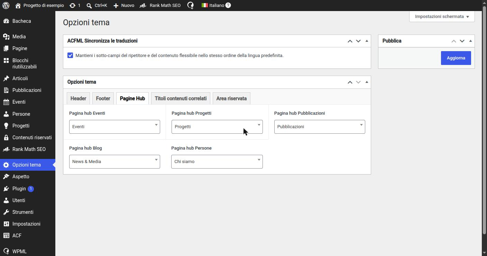

# 13. Hub di contenuti e template singoli

> 📁 **File coinvolti** ([mappa del progetto](02-struttura-progetto.md)): `includes/PostBuilder/Blocks/ContentHub.php` · `parts/post-builder/content-hub.php` · `includes/Support/HubPage.php` · `includes/Setup/HubPagePagination.php` · `single-{post-type}.php` · `parts/single-template/`

## Il problema degli archivi nativi

WordPress può generare da solo la pagina "tutti i progetti" (`has_archive => true` → `archive-project.php`). Ma quella pagina **non è una pagina**: il redattore non può aggiungerci un hero, un testo introduttivo, un banner, né tradurne il titolo come un contenuto normale.

## La soluzione: pagine hub

Un **hub** è una normale **Pagina** costruita col Post Builder che contiene il blocco **Hub contenuti** (`ContentHub`). Il blocco:

- chiede **quale post type** elencare e quanti elementi per pagina;
- facoltativamente una **selezione manuale** (un campo Relationship per ogni post type, mostrato con conditional logic);
- facoltativamente **filtri** (ricerca, temi, anno, ordinamento) gestiti con parametri GET;
- esegue una `WP_Query` e renderizza ogni risultato con la **card** di quel post type ([sezione 14](14-loop-card.md));
- passa a Vue i dati di paginazione.

Così il redattore costruisce la pagina "Progetti" come vuole, e l'elenco è solo uno dei blocchi.

## Collegare l'hub al suo post type

Il codice ha bisogno di sapere qual è la pagina hub di ogni CPT (per il breadcrumb, i link "vedi tutti", la paginazione). Le **Opzioni tema** hanno una scheda "Pagine Hub" con un campo `hub_page_{post_type}` per ciascun CPT, e l'helper `HubPage` li risolve **già tradotti nella lingua corrente** (WPML):

```php
HubPage::getInstance()->getUrl('project');   // permalink della pagina hub dei progetti
HubPage::getInstance()->getId('event');
```


*La scheda "Pagine Hub" delle Opzioni tema: ogni CPT è collegato alla pagina che fa da elenco. Nel menu laterale si vedono anche i CPT registrati dal tema.*

## La paginazione degli hub

Se la pagina hub ha lo stesso slug del CPT (pagina `/projects/` e progetti in `/projects/nome-progetto/`), l'URL `/projects/page/2/` verrebbe interpretato da WordPress come "il progetto chiamato *page*" → 404. `Setup/HubPagePagination` intercetta il filtro `request`: se il percorso è `<pagina hub>/page/N/` lo risolve verso la pagina hub con `paged=N`. Non aggiunge regole di rewrite, quindi non richiede flush.

## Template singoli

Ogni CPT pubblico ha il suo `single-{post-type}.php`. La maggior parte ha la stessa struttura:

```php
get_header();
the_post();

get_template_part('parts/single-template/hero');            // hero con titolo, riassunto, immagine
get_template_part('parts/breadcrumb');
SinglePostBuilder::render();                                // corpo a blocchi
get_template_part('parts/single-template/related-content'); // slider di contenuti correlati

get_footer();
```

**Perché un file per CPT se sono quasi identici?** Perché è la gerarchia dei template di WordPress: avere il file dedicato rende esplicito che quel tipo ha un dettaglio pubblico, e permette di divergere senza `if` sul post type (gli Eventi, ad esempio, hanno parti in più come date e luogo). Le parti comuni sono in `parts/single-template/`, quindi la duplicazione reale è di poche righe.

`related-content.php` è generico: interroga altri contenuti **dello stesso post type**, prende il titolo della sezione dalle Opzioni tema (`related_{post_type}_title`) e li mostra con le stesse card degli hub.

---

← [12. Custom post type e tassonomie](12-post-type-tassonomie.md) · [Indice](README.md) · [14. Loop di contenuti e template delle card](14-loop-card.md) →
