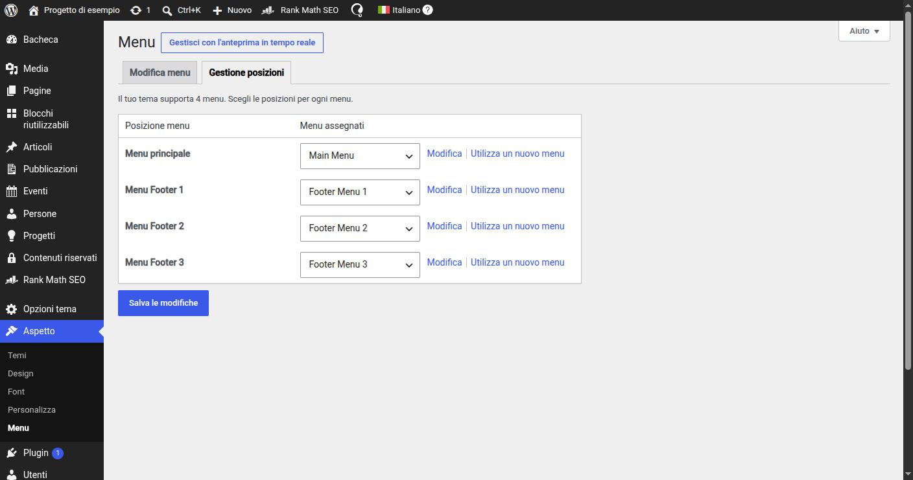

# 16. Menu di navigazione

> 📁 **File coinvolti** ([mappa del progetto](02-struttura-progetto.md)): `includes/Setup/ThemeSetup.php` · `includes/Support/Menu.php` · `header.php` · `footer.php`

## Posizioni

WordPress separa i **menu** (liste di link create dal redattore in *Aspetto → Menu*) dalle **posizioni** (slot del tema dove un menu può essere mostrato). Il tema registra le posizioni in `Setup/ThemeSetup.php`:

```php
register_nav_menus([
    'main-menu'     => __('Main Menu', 'wpx-starter'),
    'footer-menu-1' => __('Footer Menu 1', 'wpx-starter'),
    'footer-menu-2' => __('Footer Menu 2', 'wpx-starter'),
    'footer-menu-3' => __('Footer Menu 3', 'wpx-starter'),
]);
```

Il redattore crea i menu e li assegna alle posizioni; il codice chiede sempre il menu **per posizione**, mai per nome o ID (che cambiano tra ambienti e lingue).


*"Aspetto → Menu → Gestione posizioni": le quattro posizioni registrate da `ThemeSetup`, ciascuna con il menu assegnato dal redattore.*

## Da menu WordPress a dati per Vue

La funzione nativa `wp_nav_menu()` stampa direttamente HTML con le sue classi: inutilizzabile con un componente Vue. L'helper `Support/Menu` restituisce invece il menu come **albero di array**:

```php
Menu::getInstance()->get(['theme_location' => 'main-menu', 'depth' => 3]);
// [
//   ['ID' => 12, 'title' => 'Chi siamo', 'url' => '…', 'target' => '_self', 'is_current' => true,
//    'classes' => [ … ], 'children' => [ … ]],
//   …
// ]
```

Internamente:

- legge gli elementi del menu e calcola le classi di contesto di WordPress (`current-menu-item`, `current-menu-ancestor`…) per sapere quale voce è **attiva**;
- applica il filtro standard `wp_nav_menu_objects` (compatibilità con plugin);
- normalizza ogni voce in un array pulito e costruisce l'albero rispettando `depth`.

L'albero viene messo nel `data-config` di `HeaderCmp`/`FooterCmp` e usato anche per il markup di fallback.

---

← [15. Opzioni tema, header e footer](15-opzioni-header-footer.md) · [Indice](README.md) · [17. La pagina 404](17-pagina-404.md) →
