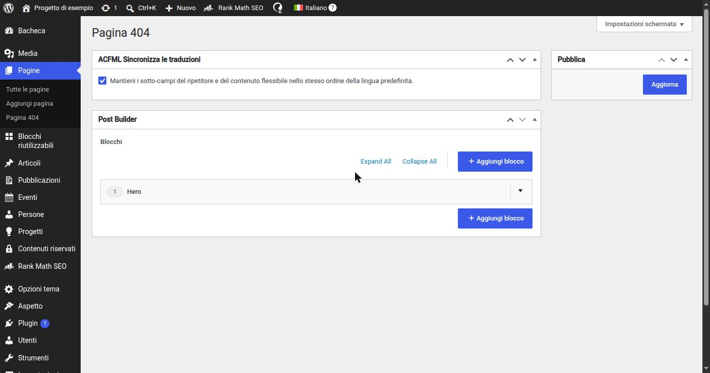

# 17. La pagina 404

> 📁 **File coinvolti** ([mappa del progetto](02-struttura-progetto.md)): `404.php` · `includes/AcfFields/Bootstrap.php` · `includes/PostBuilder/PostBuilder.php`

WordPress, quando non trova un contenuto, esegue `404.php`. Tipicamente il testo della 404 è scritto nel template: non modificabile dai redattori e non traducibile come contenuto.

Qui la 404 è **costruita col Post Builder**, come una pagina normale:

1. viene registrata un'**options page** dedicata, come sottovoce di *Pagine* (`menu_slug => 'error-404-page'`);
2. il `PostBuilder` include quella options page tra le sue `locations()`:

   ```php
   Location::where('options_page', 'error-404-page'),
   ```

3. `404.php` renderizza il builder leggendo i dati dalle opzioni invece che da un post:

   ```php
   get_header();
   PostBuilder::render('option');
   get_footer();
   ```


*La 404 in bacheca: una sottovoce di "Pagine" che contiene lo stesso Post Builder delle pagine, ma senza titolo, permalink o stato di pubblicazione.*

**Perché una options page e non una "pagina 404" normale?** Una pagina normale avrebbe un URL proprio (raggiungibile, indicizzabile, eliminabile per sbaglio) e richiederebbe un'opzione per sapere quale pagina usare. L'options page esiste sempre, ha un solo scopo e non ha URL.

---

← [16. Menu di navigazione](16-menu.md) · [Indice](README.md) · [18. Traduzioni: stringhe del tema e contenuti](18-traduzioni.md) →
